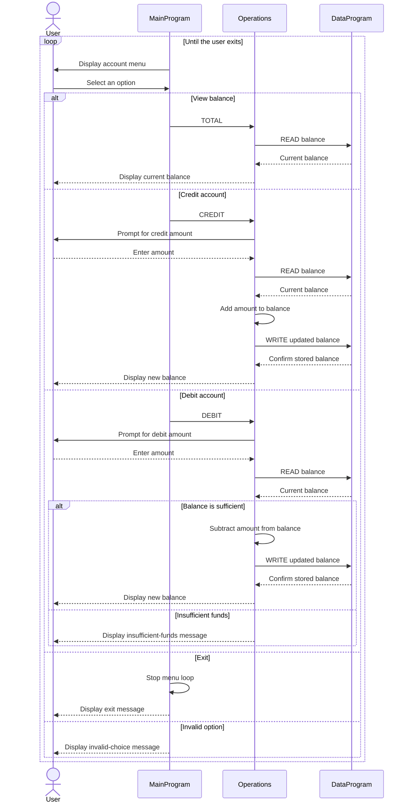

# COBOL Student Account Program

## Purpose

This COBOL program is a small account-management example for a single student account. It provides a console menu to view the balance, credit (deposit) the account, debit (withdraw) from it, or exit. The account is not associated with a student ID or profile, and the program does not persist data between runs.

## Source Files

- [`main.cob`](../src/cobol/main.cob) (`MainProgram`) displays the menu, reads the user's selection, and dispatches account actions to `Operations`. Choices 1, 2, and 3 request a balance view, credit, and debit; choice 4 exits. Other choices produce an invalid-choice message.
- [`operations.cob`](../src/cobol/operations.cob) (`Operations`) implements the account actions. It reads the balance before displaying or changing it, prompts for an amount for credits and debits, and writes an updated balance after a successful change.
- [`data.cob`](../src/cobol/data.cob) (`DataProgram`) owns the balance in working storage and exposes `READ` and `WRITE` operations through its linkage parameters. The starting balance is `1000.00`.

## Student Account Business Rules

- The account starts with a balance of `1000.00` each time the program runs. The balance is held in memory; no file or database storage is used.
- A credit adds the entered amount to the current balance.
- A debit is allowed only when the current balance is greater than or equal to the entered amount. Otherwise, the program displays an insufficient-funds message and leaves the balance unchanged.
- Amounts and balances use `PIC 9(6)V99`, representing up to six digits before and two digits after an implied decimal point. The program does not display a currency symbol or identify a currency.
- The program does not validate that an entered amount is positive or enforce a student-specific limit. Such rules are not implemented in the current source.

## Data Flow

